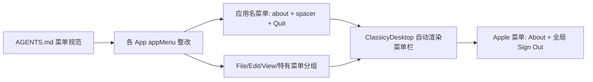

## Product Overview
按照 AGENTS.md「菜单设计规范（macOS / classicy）」章节，对 watchdog-os 全部 9 个桌面 App（MonitorApp、DockerApp、ImcolinApp、TerminalApp、FinderApp、EditorApp、RunnerApp、PrinterApp、ChatApp）的 appMenu 进行合规整改。本次为菜单结构与文案的逻辑整改，不改变任何业务功能与交互行为，不新增 Help 菜单内容。

## Core Features
- 统一菜单结构：appMenu 第一组为应用名菜单（`About X`（`useClassicyAboutMenu`）+ spacer + `Quit`），`aboutWindow` 渲染进组件树
- 删除 7 个 App 违规自建的 `System > Sign Out` 菜单（Apple 菜单已有全局 Sign Out）
- 中文菜单文案全部改为英文 Title Case（含 `src/quitMenuItem.ts` 的 `退出` → `Quit`）
- 菜单项 id 全部规范为 `<app前缀>-m-<命令>`，分隔线统一 `{ id: 'spacer' }`
- TerminalApp 字号/字体子项的手动 `✓ ` 前缀改为 `checked` 字段
- EditorApp 快捷键 `Cmd+S` 式写法改为符号字形 `⌘S` / `⇧⌘Z`
- RunnerApp、ChatApp 的 appMenu 补 `useMemo`
- FinderApp 菜单命令在无目录选中时置 `disabled`（不隐藏）；File/View 命令按类别归位
- 有普通文本输入的 App（FinderApp、ChatApp）引入 `useClassicyEditMenu(idPrefix)`
- 弹窗类命令保持/补齐 `…` 后缀（如 `New Session…`、`New Folder…`）


## Tech Stack
- 沿用现有技术栈：React 19 + TypeScript + Vite，UI 组件库 classicy v0.79.0（仿 Mac OS 9 桌面）
- 仅修改前端 `src/` 下 10 个文件（9 个 App + `src/quitMenuItem.ts`），后端 `server.js` 不动

## Implementation Approach
- **统一模板**：按 AGENTS.md「新增应用菜单的最小模板」逐 App 改造。每个 App 调用 `useClassicyAboutMenu(APP_ID, APP_NAME, ICON)` 取得 `aboutMenuItem`（置于应用名菜单首项，自动提升进 Apple 菜单），并将 `aboutWindow` 渲染进组件树；Quit 继续使用项目封装 `src/quitMenuItem.ts`（走 `ClassicyAppClose`，与 classicy `quitMenuItemHelper` 等价，保留封装避免全局替换）。
- **删除 System/Sign Out**：`src/Desktop.tsx` 的 `AppleMenuLogoutItem`（L46-83）已向 Apple 系统菜单注入全局 `Sign Out`（id `sp-menu-logout`），7 个 App 自建的 `System > Sign Out` 纯属重复，直接删除；MonitorApp 的 `handleLogout` 引用随之清理。FinderApp 登出仅由 401 触发，不受影响。
- **Edit 菜单分级处理**（关键决策）：
  - FinderApp（路径/对话框 `ClassicyInput`）与 ChatApp（原生 `<textarea>`）：使用 `useClassicyEditMenu(idPrefix)`，hook 作用于最后聚焦的标准文本框，符合规范。
  - EditorApp：主体是 CodeMirror（非 DOM 文本框），hook 的 execCommand 机制不生效，保留自建 Edit 组（Undo/Redo 内联调用 CodeMirror 命令），按规范修正文案与符号快捷键，符合「操作对象不是文本框才自建并内联实现」的例外条款。
  - TerminalApp：主体是 xterm（自行处理键盘输入，非标准文本框），不引入 Edit 菜单，避免干扰终端按键处理；其设置对话框输入框可由浏览器原生编辑操作覆盖。
- **文案/快捷键/id**：全部英文 Title Case；`keyboardShortcut` 用符号字形（`⌘S`、`⇧⌘Z`、`⌥H`）；id 统一 `<前缀>-m-<命令>`；`quitMenuItem.ts` 内部 id 从 `${appId}:quit` 改为 `${appId}-m-quit`。
- **状态表达**：切换项一律 `checked` 字段；命令不可执行时保留菜单项并置 `disabled`，禁止条件渲染隐藏（FinderApp appMenu 的 New Folder/New Text File/Upload 对齐右键菜单的 `disabled: !current` 语义）。
- **性能**：所有 appMenu 保持/补齐 `useMemo`（classicy 菜单渲染与 Help 注册依赖引用稳定）；不新增运行时开销。

## Architecture Design
改动集中在 `src/apps/*.tsx` 各 App 组件的 `appMenu` 定义处，均为局部改动，不触碰数据流、轮询逻辑、后端 API：



## Directory Structure Summary
```
d:/fankangsong/watchdog-os/src/
├── quitMenuItem.ts          # [MODIFY] id 改 `${appId}-m-quit`，title '退出'→'Quit'，影响全部 9 个 App
├── apps/
│   ├── MonitorApp.tsx       # [MODIFY] 应用名菜单补 about；删 System/Sign Out；id 规范化；渲染 aboutWindow
│   ├── DockerApp.tsx        # [MODIFY] 同上（appMenu L19-33）
│   ├── ImcolinApp.tsx       # [MODIFY] 同上（appMenu L74-88）
│   ├── RunnerApp.tsx        # [MODIFY] 同上 + appMenu 补 useMemo（L55-66）
│   ├── PrinterApp.tsx       # [MODIFY] 同上（appMenu L144-158）
│   ├── ChatApp.tsx          # [MODIFY] appMenu 补 useMemo；'新建会话'→'New Session…' 移入应用特有菜单组；加 useClassicyEditMenu（textarea）
│   ├── TerminalApp.tsx      # [MODIFY] ✓ 前缀→checked；删 System；id 规范化；补 about；不加 Edit 菜单（xterm 特殊性）
│   ├── FinderApp.tsx        # [MODIFY] 首组改应用名菜单；中文→英文；newdir/newfile/upload 置 disabled；加 useClassicyEditMenu；组 id 结构调整
│   └── EditorApp.tsx        # [MODIFY] 首组改应用名菜单；中文→英文；Cmd+X→⌘ 符号快捷键；保留自建 Edit 组并规范化
└── Desktop.tsx              # [READ-ONLY] 确认 AppleMenuLogoutItem 全局 Sign Out 注入，不改
```

## Implementation Notes
- `aboutWindow` 必须渲染进组件树，否则 About 窗口无法弹出；每个 App 在根 JSX 中加入 `{aboutWindow}`。
- appMenu 挂载位置维持现状（`ClassicyWindow` prop），本次不改挂载架构。
- 删除 System 菜单后，MonitorApp 的 `handleLogout` 若无其他引用需一并清理 import/函数，避免 TS unused 报错。
- 菜单组间用 spacer 分隔时不得出现在组首/组尾/连续位置。
- 本次不注册 `useClassicyHelpMenu`（规范为可选，无现成帮助内容）。
- 验证：`npx tsc --noEmit` 全量类型检查 + `npm run build`；后端与 fs/runner API 未动，无需重跑冒烟测试。

