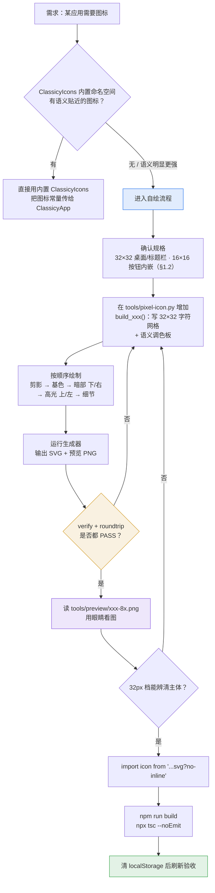

# 图标制作标准流程（SOP）

本项目全部**桌面图标 / 标题栏图标**的制作流程。规范来源是 [`design-spec.md`](./design-spec.md) §7.4；本文补充**可执行的步骤、自动校验与踩坑记录**。

> 术语：下文「图标」一律指 `src/assets/icons/*.svg`。桌面/标题栏图标为 32×32 档；工具栏按钮内嵌图标为 16×16 档（见 §1.2，本流程同样覆盖）。design-spec §3.2 规则 8 禁入按钮带的是**独立 icon 按钮**（`ClassicyBevelButton square`），不禁止 push 文字按钮携带前置图标。

---

## 0. 全流程



> **J 这一步不能省。** 本项目的绘制工具链刻意做成「生成 → 渲染 PNG → 代理自己看图 → 迭代」的闭环，像素画 90% 的问题（比例失调、明度层次糊、缩略不可辨）只有看图才能发现。

---

## 1. 规格基线

| 项 | 值 | 依据 |
|---|---|---|
| 画布 | **32×32** | classicy 内置桌面/标题栏图标实测为 32×32 PNG（详见 §1.1） |
| SVG | `viewBox="0 0 32 32" width="32" height="32"` | design-spec §7.4 |
| 元素 | 只允许 `<path>`；**禁用 `<text>` / `<font>`** | §7.4（各平台字体不一致会导致图标走形） |
| 渲染 | 加 `shape-rendering="crispEdges"` | 不加则相邻像素在 Chromium 下插值出灰缝 |
| 体积 | < 4 KB | 历史上用于 Vite 内联；**现已改为 `?no-inline` 独立文件**（见 §6.2） |
| 立体感 | 浮雕高光（顶/左）+ 暗边（下/右），**不加投影** | §7.4 |
| 导入方式 | **必须** `?no-inline` | 见 §6.2，这是硬性要求 |

### 1.1 为什么是 32×32（实测数据）

classicy 内置图标是**内联 PNG data URI**，不是 SVG。解析其 PNG IHDR 头，全包 349 个图标的尺寸分布：

| 尺寸 | 数量 | 用途 |
|---|---|---|
| **32×32** | **180** | 桌面 / 标题栏 ← 本流程的目标档 |
| 16×16 | 70 | 工具栏 |
| 128×128 | 25 | 应用大图 |
| 16×12 / 26×22 / 其他 | 74 | 杂项（文件类型、特殊形状） |

**结论：桌面与标题栏同档 32×32。** 这是硬指标，不是估的。

### 1.2 16×16 档：窗口操作按钮带内嵌图标

按钮带（design-spec §3.2）的 push 文字按钮可携带**前置图标**（Back / Up / Favorites 三枚，`src/assets/icons/fm-*.svg`）。规格与约定：

| 项 | 值 | 依据 |
|---|---|---|
| 画布 | **16×16**，`viewBox="0 0 16 16"` | design-spec §7.4「工具栏图标 16px 档」 |
| 渲染 | **1:1** 渲染在 16px（`.sp-tb-icon` 宽高 16px） | 缩放即糊，16 档没有缩小空间 |
| 尺寸依据 | 按钮 20px 高（`--hig-button-height`）− 边框 2px − 内边距 2px = 16px 内容盒，图标恰好填满并随按钮 flex 行垂直居中；文字 12px，图标 ≤ 文字盒 | §3.2.2 规则 5 |
| 颜色 | **单色 `currentColor`**（调色板键 `C`） | 跟随宿主按钮文字色：启用黑 / 禁用灰（`sp-toolbar :disabled`）/ 按下白（classicy `:active`），三态零成本一致，禁用以滤镜模拟 |
| 元素 | 同 32 档：仅 `<path>`、无 `<text>`、`crispEdges`、≥1px 透明边 | §7.4 / skills/pixelart |
| 导入 | 同样必须 `?no-inline` | §6.2 |

生成方式与 32 档同链路：`tools/pixel-icon.py` 里 `set_size(16)` 后新增 `build_xxx()`（用 `blit` 贴 16 列字符行），在 `__main__` 的 16 档区块加一行 `emit(build_xxx(), 'xxx')`。`verify` / `roundtrip` / `preview` 均按当前 `W/H` 自适应；16 档预览只出 `xxx-8x.png`（本身就是目标尺寸，不再缩 16px 观感）。

接入样式（`src/styles.css`，与 `.sp-toolbar` 规则同址）：

```css
.sp-toolbar .classicyButton:has(.sp-tb-icon) { display: inline-flex; align-items: center; justify-content: center; gap: 5px; }
.sp-toolbar .classicyButton .sp-tb-icon { width: 16px; height: 16px; flex: 0 0 auto; image-rendering: pixelated; }
```

`:has()` 把影响面限制在带图标的按钮上，无图标按钮（如 WatchDog OS 的 Refresh Now）布局零变化。接入后仍需过 §4 检查清单（`npm run build` 后确认 dist 产物是独立 `.svg` 文件而非 data URI）。

---

## 2. 绘制规范

沿用 `skills/pixelart`（YoYoPixel，MIT）的 ≤48px 档约定：

| 项 | 规则 |
|---|---|
| 源表示 | 字符网格（每字符 1 像素）+ 语义调色板（单字符键 → hex） |
| 透明 | `.` 恒为透明 |
| 光源 | **左上** → 顶/左压亮，下/右压暗 |
| 边框 | 至少 1px 透明边 |
| 色数 | 32×32 档 8～16 色（实际两枚用了 8 / 9） |
| 绘制顺序 | ① 剪影 → ② 基色（每材质一色） → ③ 暗部（下/右） → ④ 高光（上/左） → ⑤ 细节 → ⑥ 缩略可辨性检查 |

**配色**：沿用既有图标取色，换画法不换色，桌面整体色调不跳。已固化在 `tools/pixel-icon.py` 的 `PALETTE`：

| 键 | 值 | 用途 |
|---|---|---|
| `K` | `#3a3a44` | 窗口描边（Platinum 黑边） |
| `D` `M` `L` `W` | `#6f6f7c` `#a0a0ab` `#d8d8de` `#ffffff` | 面板暗→亮四级 |
| `S` `B` `T` | `#282830` `#111116` `#f6f6f8` | 屏幕外圈 / 屏底 / 终端文字 |
| `N` `b` `m` `h` | `#1b3d72` `#4a86d8` `#2a62b2` `#a8cff5` | 蓝色气泡描边/基/暗/高光 |
| `O` `w` `d` `g` | `#2b2b33` `#f4f4f8` `#dcdde7` `#71717f` | 白色气泡描边/基/暗/灰文本 |
| `N` `b` `m` `h` | `#1b3d72` `#4a86d8` `#2a62b2` `#a8cff5` | Docker 鲸描边/基/暗/高光 |
| `G` `P` `p` | `#2c6e31` `#46a049` `#7cc47f` | Runner 播放键暗/基/高光 |
| `C` | `currentColor` | 16 档按钮字形专用：单色跟随宿主文字三态（§1.2），非固定色 |

---

## 3. 工具

`tools/pixel-icon.py`（零依赖，仅标准库 `re` / `struct` / `zlib` / `os`）

| 能力 | 说明 |
|---|---|
| 构建 | `build_terminal()` / `build_chat()` / `build_docker()` / `build_runner()`（32 档）与 `build_fm_back()` / `build_fm_up()` / `build_fm_fav()`（16 档）—— 用 `fill` / `hline` / `roundbox` / `blit` 画网格；异形主体（鲸、三角）用 `sil_rect()` 搭剪影 + `bevel()` 上立体色 + `outline()` 描外框 |
| 尺寸切换 | `set_size(32/16)` —— 全部绘制/输出函数调用时读全局 `W/H`，构建前切一次即可；`to_svg` / `verify` / `preview` 随之自适应 |
| 合并 | `merge_rects()` 贪心最大同色矩形（先横向游程、再纵向扩展） |
| 输出 | `to_svg()` 每色一个 `<path>`，`M x y h w v h h -w z`；浅色先画、深色后画 |
| 自检 | `verify()` 校验 §7.4 硬约束与矩形不重叠 |
| **回读** | `parse_svg_grid()` 解析**落盘文件**还原网格，与源网格逐像素比对 |
| **源码守卫** | `lint_imports()` 扫 `src/**/*.{ts,tsx}`，发现图标 import 没带 `?no-inline` 即 **exit 1** |
| 预览 | `rasterize()` 从 SVG 几何光栅化 → 8x 预览；`shrink()` 降采样出「16px 档观感」（仅 32 档输出） |

新增图标 = 复制一份 `build_xxx()`，在 `__main__` 里加一行 `emit(build_xxx(), 'xxx')`。

---

## 4. 交付前检查清单

```
□ 生成器输出 verify: PASS
□ 生成器输出 roundtrip: PASS          ← 抓 §6.1 的 bug
□ 生成器输出 imports: PASS            ← 机器强制，抓 §6.2 的 bug
□ svg 体积 < 4 KB
□ 只含 <path>，无 <text> / <font>
□ viewBox="0 0 32 32" + shape-rendering="crispEdges"
□ 读过 tools/preview/xxx-8x.png，32px 档主体可辨
□ npm run build 成功
□ dist 产物形态符合预期（独立 .svg 文件，无 data URI）
□ npx tsc --noEmit 通过
□ 提醒用户清 localStorage（§6.3）
```

> 前三项由 `python tools/pixel-icon.py` 自动校验并在失败时 `exit 1`，不依赖人 review。

---

## 5. 接入

本项目**不是**在 `src/Desktop.tsx` 里注册图标（那里只挂载组件、不含图标代码），而是**应用组件自己注册**。三步：

### ① 应用组件内定义常量

```ts
// src/apps/TerminalApp.tsx
import terminalIcon from '../assets/icons/terminal.svg?no-inline';

const APP_ID = 'srv-terminal.app';     // 必须以 .app 结尾
const APP_NAME = 'Terminal';
/** 应用图标：自绘 SVG（Mac OS 9 窗口 + 终端提示符），见 src/assets/icons/terminal.svg */
const ICON = terminalIcon;
```

### ② 用 `ClassicyApp` 注册，窗口的 `icon` 决定标题栏图标

```tsx
<ClassicyApp id={APP_ID} name={APP_NAME} icon={ICON} defaultWindow="terminal-main">
  <ClassicyWindow id="terminal-main" title={APP_NAME} icon={ICON} appId={APP_ID} … />
```

`ClassicyApp` 的 `icon` → 桌面图标；`ClassicyWindow` 的 `icon` → 标题栏图标。两者都要传，否则标题栏会退回内置图标。

### ③ 在 `src/Desktop.tsx` 挂载组件

```tsx
<ClassicyDesktop …>
  <TerminalApp onLogout={onLogout} />
```

`Desktop.tsx` **不含任何图标代码**，不需要为换图标而改动它。

### import 写法（硬性要求）

```ts
// ✅ 正确
import terminalIcon from '../assets/icons/terminal.svg?no-inline';

// ❌ 错误：会被内联成 data URI，遮罩失效（见 §6.2）
import terminalIcon from '../assets/icons/terminal.svg';

// ❌ 也不够：?url 不绕过 assetsInlineLimit
import terminalIcon from '../assets/icons/terminal.svg?url';
```

> ⚠️ design-spec §7.4 写的「在 `src/Desktop.tsx` 登记」在本项目是**过时表述**，实际以本节为准。

---

## 6. 踩坑记录

### 6.1 `d` 路径漏高度 —— 预览正常但文件残缺

```python
# ❌ v1 写死，高度 h 被丢弃
d = ''.join('M%d %dh%dv1h-%dz' % (x, y, w, w) for (x, y, w, h) in by_color[c])

# ✅
d = ''.join('M%d %dh%dv%dh-%dz' % (x, y, w, h, w) for (x, y, w, h) in by_color[c])
```

`merge_rects()` 会把同色区域合并成**最大矩形**（如终端屏幕 = 1 个 24×16 矩形），但拼路径时高度写 1，**纵向合并出的大矩形只画最上面一行**。后果：SVG 大面积镂空 → 露出 classicy 的黑色底 → 看起来像「图标有黑色背景」。

**为什么最初没发现**：预览图是直接用内存里的 `rects`（带真实 `h`）光栅化的，而 SVG 文件是按坏的字符串写的 —— 两条路径分叉，预览正常掩盖了文件残缺。

**防回归**：
1. `parse_svg_grid()` 回读落盘文件逐像素比对源网格
2. 预览一律来自 `parse_svg_grid()` 的结果，**不走内存 rects**

> 教训：任何「预览」都必须与「最终产物」走同一条数据通路，否则校验就是自欺欺人。

### 6.2 Vite 内联 SVG 会让 classicy 的遮罩失效

classicy 把图标地址写进 CSS 自定义属性：

```jsx
<div className="classicyDesktopIconMaskOuter" style={{"--classicy-icon-mask": `url(${A})`}}>
```

而 Vite 的 `svgToDataURL`：

```js
if (content.includes("<text") || content.includes("<foreignObject") || nestedQuotesRE.test(content))
  return `data:image/svg+xml;base64,${content.toString("base64")}`   // ← base64 分支
else
  return "data:image/svg+xml," + content.trim()
    .replaceAll('"', "'")        // ← 双引号全变单引号
    ...
```

自绘 SVG 没有 `<text>` / `<foreignObject>` / 嵌套引号 → 走 **plain 分支** → 产出 `data:image/svg+xml,<svg xmlns='...'>`。

**CSS 的无引号 `url()` 不允许出现 `'`**（也不允许 `"`、空格、括号）→ 整条声明非法 → 浏览器 CSSOM 拒绝 `setProperty` → **`style` 属性整个消失**。

诊断信号（DevTools 里一眼可见）：

```html
<!-- 内置 PNG：正常 -->
<div class="classicyDesktopIconMaskOuter" style="--classicy-icon-mask: url(data:image/png;base64,…)">
<!-- 自绘 SVG：style 属性整个没了 -->
<div class="classicyDesktopIconMaskOuter">
```

**解法：`?no-inline`**（注意 `?url` **不够**，它不绕过 `assetsInlineLimit`）。

**防回归：`lint_imports()`**。这类 bug 的恶劣之处在于**完全静默** —— 浏览器丢弃非法 CSS 值时页面不报错、控制台无输出，肉眼 review 极易漏。`tools/pixel-icon.py` 会扫 `src/**/*.{ts,tsx}`，发现图标 import 缺 `?no-inline` 直接 `exit 1`。已用两种错误写法（无查询串、`?url`）实测拦截。

> 这是**历史遗留**：旧的渐变版图标同样中招（且更糟 —— 渐变里的 `url(#term-shell)` 连括号都是非法的）。不是某次改动引入的。

### 6.3 classicy 把应用注册信息持久化在 localStorage

其注册 reducer **对已存在条目不更新 `name` / `icon`**。换图标后老用户必须：

```js
localStorage.removeItem('classicyDesktopState'); location.reload();
```

---

## 7. classicy 桌面图标的渲染机制

排查图标显示异常时需要知道的三层结构：

```
┌─ .classicyDesktopIconImage
│   └─ .classicyDesktopIconMaskOuter      尺寸 iconSize + border
│   │   │   background: var(--color-black) !important   ← 纯黑底，无条件生效
│   │   │   mask-image: var(--classicy-icon-mask)      ← 遮罩 = 图标自身 alpha
│   │   └─ .classicyDesktopIconMask      尺寸 iconSize − border×2
│   │       │   background-image: 内联 SVG 斜纹网格
│   │       │   mask-image: var(--classicy-icon-mask)
│   │       └─                      尺寸 var(--desktop-icon-size)（默认 64）
```

- `--color-black: #000000` 定义在本项目 `src/styles.css`
- `--window-border-size: 1px`、`--desktop-icon-size` 来自 classicy 主题

**推论**：遮罩失效时（§6.2），黑底与斜纹不再被裁剪成图标轮廓，而是直接铺满，`` 的**透明边距会让斜纹透出来**。若要排查图标「有背景」，先确认 `style` 属性是否存在。

内置 PNG 图标走 base64 分支，遮罩正常，所以看不到这层 —— 这也是自绘图标与内置图标观感不一致的根因之一。

---

## 8. 环境注意事项

| 事项 | 说明 |
|---|---|
| **Python 解释器** | `python` 命令命中 Windows Store 空壳（exit 9009）。用 mise 真实路径：`C:\Users\fanks\.local\share\mise\installs\python\3.12.13\python.exe` |
| **Node 路径** | shim 在 `C:\Users\fanks\AppData\Local\mise\shims\node.exe`（注意：**不是** `.local\share\mise\...`） |
| **PowerShell** | `Get-Content` 不带 `-Encoding` 会被 Craft 钩子拦截（GBK/UTF-8 误判风险），统一加 `-Raw -Encoding utf8` |
| **`cmd /c`** | 会吞掉 `;` 之后的 PowerShell 命令，混用要拆成独立调用 |
| **子路径部署** | `base: './'` 下资源 URL 走 `new URL(x, import.meta.url)` 相对解析，`/tkp/` 子路径可正常命中 |

---

## 9. 相关文件

| 路径 | 用途 |
|---|---|
| `docs/design-spec.md` §7.4 | 图标规范**唯一权威来源** |
| `src/assets/icons/*.svg` | 交付物 |
| `tools/pixel-icon.py` | 生成器 + 校验器 |
| `tools/preview/*.png` | 预览（非交付物，可删） |
| `tools/_prev-icons/*.svg` | 原图备份（`src/assets/` 曾未被 git 跟踪，覆盖前务必备份） |
| `skills/pixelart/` | 通用像素画技能（MIT），本文档是**项目专用**约束层 |
